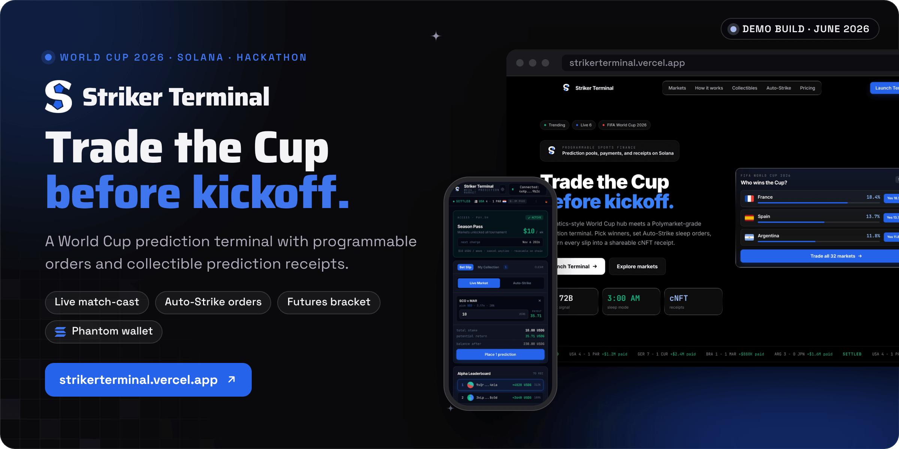

<div align="center">



<br><br>

<a href="https://strikerterminal.vercel.app/terminal"></a>&nbsp;&nbsp;
<a href="https://drive.google.com/file/d/1gkHdDcdZm2Mt6ZCDiBHOgvoh-URdgkmO/view?usp=sharing"></a>&nbsp;&nbsp;
<a href="https://drive.google.com/file/d/1TNTdpYH7fFGlU-dV9lNJ8MBBA2Nj1ccW/view?usp=sharing"></a>

<br><br>

<a href="https://strikerterminal.vercel.app"></a>


<a href="LICENSE"></a>

<h3>Trade the World Cup. One weekly pass. Every market.</h3>

<b>Connect</b> &nbsp;→&nbsp; <b>Unlock</b> &nbsp;→&nbsp; <b>Predict</b> &nbsp;→&nbsp; <b>Automate</b> &nbsp;→&nbsp; <b>Settle</b> &nbsp;→&nbsp; <b>Collect</b>

<br>

<a href="#how-it-works">How it works</a> &nbsp;·&nbsp;
<a href="#what-shipped-in-the-hackathon">What shipped</a> &nbsp;·&nbsp;
<a href="#status">Status</a> &nbsp;·&nbsp;
<a href="#run-it-locally">Run it locally</a>

</div>

<br>

<picture>
  <source media="(prefers-color-scheme: dark)" srcset="docs/readme/screens-dark.png">
  
</picture>

<p align="center"><sub>Captured from a local production build (<code>pnpm build && pnpm start</code>) in demo mode on 30 October 2026: mock markets and simulated signatures, no real transactions. The landing hero's background video streams from a CDN and is not in the banner capture.</sub></p>

**Striker Terminal is a World Cup 2026 prediction terminal: one weekly pass unlocks every market, Auto-Strike queues conditional orders before a 3 AM kickoff, and every position becomes a collectible receipt card.** World Cup matches air in the middle of the night in Southeast Asia, so the idea is to program the order before bed instead of trading live. This repository is the hackathon build: a Next.js front end that runs end to end in demo mode, with typed seams where the Solana programs, the pay.sh stream, the Metaplex Bubblegum mint and an order keeper plug in. One environment variable switches the same flows to a real Phantom wallet on Solana devnet.

Built by Matt ([RVAClassic](https://x.com/rvaclassic), [Operator Uplift](https://operatoruplift.com)) between 16 and 20 June 2026 for the Superteam and Kracked Devs WC26 hackathon.

<br>

## How it works

<picture>
  <source media="(prefers-color-scheme: dark)" srcset="docs/readme/flow-dark.png">
  
</picture>

<table>
  <tr valign="top">
    <td width="33%"><b>Demo mode by default</b><br><sub>Unless <code>NEXT_PUBLIC_USE_MOCKS</code> is <code>false</code>, the terminal uses mock markets, a simulated Phantom connection and staged signatures, and keeps its state in <code>localStorage</code>. It makes no RPC calls and sends no transactions, and <b>reset demo</b> returns to a cold wallet.</sub></td>
    <td width="33%"><b>One store, one switch</b><br><sub>Connect, subscribe, place, deploy Auto-Strike, lock a future, settle and mint all run through <code>TerminalStore</code>, so both modes share one UI, and every signed action moves through the same stages: signing, submitting, confirming, confirmed.</sub></td>
    <td width="33%"><b>Seams, clearly marked</b><br><sub>pay.sh, the Anchor programs, the Bubblegum mint, the keeper and oracle settlement each have a typed function in <code>src/lib</code> or the store that returns nothing until the real piece exists. Live mode signs a zero-lamport self-transfer in their place.</sub></td>
  </tr>
</table>

<p align="center"><sub>Next.js 16 (App Router, Turbopack) · React 19 · TypeScript · Tailwind CSS 4 · @solana/web3.js 1.98 · Solana wallet adapter (Phantom) · @coral-xyz/anchor 0.30 · @solana/spl-token 0.4</sub></p>

<br>

## What shipped in the hackathon

Everything below was merged to `main` on 20 June 2026, four days after the repository was created.

<table>
  <tr valign="top">
    <td width="33%"><b>Landing page</b> &nbsp;<code>/</code><br><sub>A "Who wins the Cup?" odds hero, a settled-results ticker, how it works in three steps, the Season Pass, a Solana stack logo bar, leaderboard and trollbox previews, Alpha Cards, Auto-Strike, three weekly tiers (Kickoff, Season Pass, Syndicate) and an FAQ.</sub></td>
    <td width="33%"><b>Trading terminal</b> &nbsp;<code>/terminal</code><br><sub>A wallet gate, the Season Pass console, four daily markets with a live match-cast, a bet slip with Live Market and Auto-Strike modes, an eight-tie Round of 32 bracket, demo settlement, share cards, an Alpha leaderboard, a trollbox, and light and dark themes.</sub></td>
    <td width="33%"><b>Integration seams</b> &nbsp;<code>src/lib</code><br><sub>A devnet connection and balance reads, one sign, send and confirm pipeline, an Anchor provider and program loader, a pay.sh stream client, Bubblegum receipt metadata, and a mock or live data layer with account transforms.</sub></td>
  </tr>
</table>

<br>

## Status

<table>
  <tr valign="top">
    <td width="16%" align="center"></td>
    <td>Built for the Superteam and Kracked Devs WC26 hackathon: scaffolded on 16 June 2026, then the terminal, landing sections, logos and holographic cards landed on 20 June in five pull requests. No placing is recorded in this repository or on the operatoruplift profile.</td>
    <td width="22%"><a href="https://github.com/operatoruplift/striker-terminal/pulls?q=is%3Apr+is%3Amerged">Merged pull requests</a></td>
  </tr>
  <tr valign="top">
    <td align="center"></td>
    <td>The demo at <a href="https://strikerterminal.vercel.app">strikerterminal.vercel.app</a>. Vercel's production deployment is built from <code>main</code> (commit <code>32f839b</code>, redeployed 12 July 2026, ready when checked on 30 October 2026) and does not set <code>NEXT_PUBLIC_USE_MOCKS</code>, so it runs in demo mode with no real transactions.</td>
    <td><a href="https://strikerterminal.vercel.app/terminal">Open the terminal</a></td>
  </tr>
  <tr valign="top">
    <td align="center"></td>
    <td>Live mode on Solana devnet: Phantom connects, the SOL balance is read from the cluster, and the Season Pass authorization sends a real signed transaction (a zero-lamport self-transfer standing in for the pay.sh stream). Markets show the RPC error view because no program is deployed, so the other flows have nothing to act on yet. Not exercised for this README.</td>
    <td><a href="src/lib/solana/tx.ts">Transaction pipeline</a></td>
  </tr>
  <tr valign="top">
    <td align="center"></td>
    <td>The Anchor prediction and futures programs, the pay.sh stream SDK, the Bubblegum cNFT mint, an Auto-Strike keeper and oracle settlement. Each has a seam in the code; none is deployed or wired.</td>
    <td><a href="src/lib">Integration seams</a></td>
  </tr>
</table>

<br>

## Run it locally

<table>
  <tr valign="top">
    <td width="33%"><b>Prerequisites</b><br><sub>Node 20.9 or newer (Next.js 16; Vercel builds this project on Node 24) and pnpm 10. A Phantom wallet only for live mode.</sub></td>
    <td width="33%"><b>Read first</b><br><sub><a href="src/lib/config.ts"><code>src/lib/config.ts</code></a> holds the demo or live switch and explains what each optional setting does.</sub></td>
    <td width="33%"><b>What the checks prove</b><br><sub>Types, lint and a production build. There are no automated tests in this repository.</sub></td>
  </tr>
</table>

### 1. Run the demo

```bash
git clone https://github.com/operatoruplift/striker-terminal.git
cd striker-terminal
pnpm install
pnpm dev          # http://localhost:3000 (landing) and /terminal, in demo mode
```

In the terminal, press **Connect Phantom** (simulated in demo mode), activate the Season Pass, then tap outcomes to fill the slip. **Reset demo** clears the saved state.

### 2. Check it

```bash
pnpm exec tsc --noEmit     # TypeScript, strict mode
pnpm lint                  # ESLint with the Next.js core web vitals and TypeScript rules
pnpm build && pnpm start   # production build, served on http://localhost:3000
```

### 3. Switch to live mode (optional)

```bash
cp .env.example .env.local   # then uncomment NEXT_PUBLIC_USE_MOCKS=false and any ids you have
pnpm dev
```

Every variable is optional, and each line in `.env.example` stays commented out until you need it: an empty `NEXT_PUBLIC_RPC_ENDPOINT=` is not the same as unset and stops the terminal from loading.

| Variable | When unset | Effect when set |
|---|---|---|
| `NEXT_PUBLIC_USE_MOCKS` | Demo mode | `false` uses a real Phantom wallet and devnet transactions. Market reads then fail cleanly into the RPC error view, since no program is deployed. |
| `NEXT_PUBLIC_RPC_ENDPOINT` | Solana devnet (`clusterApiUrl("devnet")`) | RPC for the wallet connection, balances and transactions. |
| `NEXT_PUBLIC_USDG_MINT` | A mocked 250 USDG balance | The USDG balance is read from the wallet's associated token account (6 decimals assumed). |
| `NEXT_PUBLIC_PREDICTION_PROGRAM_ID` | Live mode cannot load markets | Program id for the daily markets. The account reads still need an IDL wired in `src/lib/data/index.ts`. |
| `NEXT_PUBLIC_FUTURES_PROGRAM_ID` | Live mode cannot load the bracket | Program id for the futures bracket, with the same IDL step. |
| `NEXT_PUBLIC_PAYSH_DELEGATE` | `paysh...9fKw` is displayed | The pay.sh delegate shown in the Season Pass authorization. |

<details>
<summary><b>Routes</b></summary>
<br>

| Route | Use |
|---|---|
| `/` | Landing page: hero odds card, how it works, Season Pass, logo bar, leaderboard and trollbox preview, Alpha Cards, Auto-Strike, pricing, FAQ |
| `/terminal` | The trading desk. It renders on the client only (`ssr: false`), because the wallet adapter and the store need the browser. |

The terminal's view toggle switches between **Daily Matches** and **Futures Bracket**; the slip's panel switches between **Bet Slip** and **My Collection**.

</details>

<details>
<summary><b>Repository layout</b></summary>
<br>

| Path | Contents |
|---|---|
| `src/app/` | App Router pages (the landing page and `/terminal`), the root layout, icons and the theme tokens in `globals.css` |
| `src/app-shell/` | The terminal's client entry: connection, Phantom adapter and store providers, loaded with `ssr: false` |
| `src/components/landing/` | Landing page pieces: background video, navigation, hero and scroll reveals |
| `src/components/terminal/` | The terminal view: header, market cards, slip, modals, bracket, match-cast, trollbox and share cards |
| `src/store/TerminalStore.tsx` | The single state layer and every user action |
| `src/lib/` | Config and the demo or live switch, the data layer, and the Solana, Anchor, pay.sh, Bubblegum and chat seams |
| `public/logos/` | The Striker logo and the partner marks used in the logo bar |

</details>

<details>
<summary><b>Hackathon submission</b></summary>
<br>

| Item | Link |
|---|---|
| Live demo | [strikerterminal.vercel.app](https://strikerterminal.vercel.app) |
| Walkthrough video | [Google Drive screen recording](https://drive.google.com/file/d/1gkHdDcdZm2Mt6ZCDiBHOgvoh-URdgkmO/view?usp=sharing) |
| Pitch deck | [Google Drive presentation](https://drive.google.com/file/d/1TNTdpYH7fFGlU-dV9lNJ8MBBA2Nj1ccW/view?usp=sharing) |
| Tagline | The Programmable Season Pass |

</details>

<br>

<p align="center"><sub>The code is MIT licensed (see <a href="LICENSE">LICENSE</a>). The Solana, Phantom, Jupiter, Anchor and Superteam marks in <code>public/logos</code> belong to their owners.</sub></p>

<p align="center"><sub>Built by <a href="https://rvaclassic.xyz">Matt Sim</a>, founder of <a href="https://operatoruplift.com">Operator Uplift</a>. More builds at <a href="https://github.com/operatoruplift">github.com/operatoruplift</a>. Want one built for your product? <a href="https://cal.com/rvaclassic/15min">Book a 15-minute call</a>.</sub></p>
